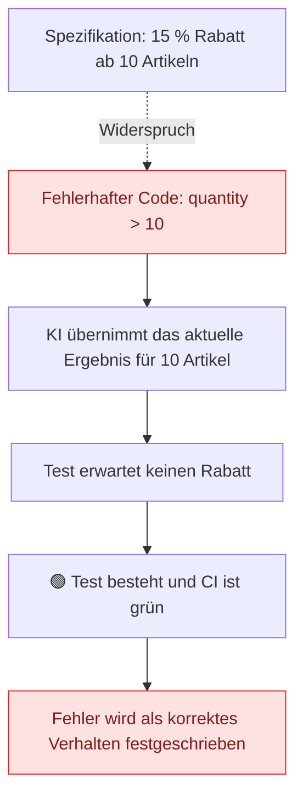
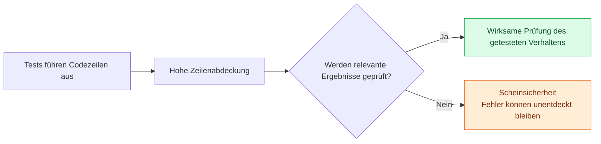
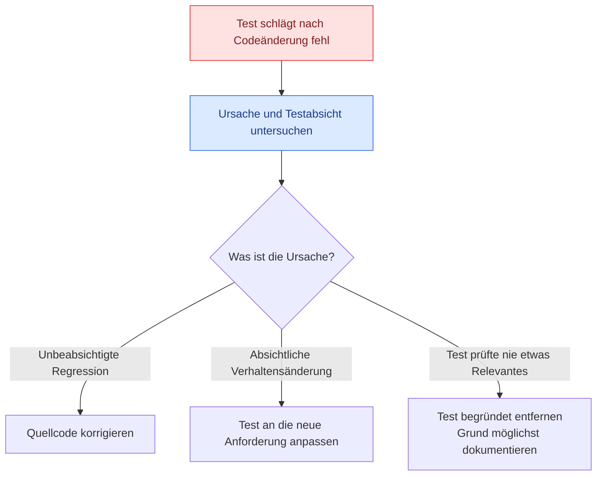

# Fallstricke der KI-Testgenerierung

> **Kernaussage:** KI-generierte Tests sind ein Ausgangspunkt für Review. Eine grüne Testsuite allein belegt nicht, dass das gewünschte Verhalten korrekt geprüft wird.

## 1. Fünf wiederkehrende Fallstricke

| Fallstrick | Was passiert? | Folge |
|---|---|---|
| **Bug Encoding – Fehlerübernahme** | Tests übernehmen einen vorhandenen Codefehler als erwartetes Verhalten | Ein Fehler wird durch grüne Tests scheinbar bestätigt |
| **Coverage Theatre – Scheinsicherheit durch Abdeckung** | Viele Codezeilen werden ausgeführt, aber relevante Ergebnisse kaum geprüft | Gute Kennzahlen trotz schwacher Fehlererkennung |
| **Test Deletion – Testlöschung** | Ein fehlgeschlagener Test wird ohne Untersuchung entfernt | Eine mögliche Regression bleibt bestehen |
| **Context Blindness – fehlender Anforderungskontext** | Tests orientieren sich am tatsächlichen Codeverhalten statt an der Spezifikation | Geschäftsregeln und Anforderungen werden verfehlt |
| **Automation Complacency – blindes Vertrauen in Automatisierung** | Ein grüner CI-Status wird akzeptiert, ohne die Aussagekraft der Tests zu prüfen | Automatisierung ersetzt die kritische Bewertung |

**Gemeinsame Ursache:** KI-Ausgaben werden als fertige Arbeit behandelt.

**Gemeinsame Gegenmaßnahme:** **Review, nicht nur ausführen.**

## 2. Fehlerübernahme: Wenn Tests einen Bug bestätigen

Die Funktion `getBulkDiscountRate` soll bei Bestellungen von **mindestens 10 Artikeln einen Rabatt von 15 %** liefern. Der Code prüft jedoch `quantity > 10` statt `quantity >= 10`.

| Menge | Spezifikation | Fehlerhafter Code |
|---:|:---:|:---:|
| 9 | Kein Rabatt | Kein Rabatt |
| **10** | **15 % Rabatt** | **Kein Rabatt ❌** |
| 11 | 15 % Rabatt | 15 % Rabatt |

Leitet die KI den Erwartungswert aus der vorhandenen Implementierung ab, kann sie für genau 10 Artikel **keinen Rabatt** erwarten. Der Test besteht, obwohl die Geschäftsregel verletzt wird.

**Warum das strukturell problematisch ist:** Wenn ein Tool das Ergebnis der Implementierung als alleinige Quelle für den Erwartungswert verwendet, fehlt eine unabhängige Prüfung auf Korrektheit.

**Review-Fokus:** Erwartungswerte mit der Spezifikation abgleichen – besonders an Grenzen und Schwellen.

## 3. Coverage Theatre: Ausgeführt heißt nicht wirksam geprüft

Die Rauchmelder-Analogie des Vortrags: Ein Sensor kann bei einem Feuer aktiv werden, ohne das Feuer zuverlässig zu erkennen. Ebenso kann ein Test Code ausführen, ohne dessen Fehler zu entdecken.

| Ursache | Beispiel | Warum der Test schwach ist |
|---|---|---|
| **Schwache Assertions** | Nur prüfen, ob das Ergebnis nicht `null` ist | Ein falsches, aber vorhandenes Ergebnis besteht ebenfalls |
| **Doppelte Tests** | Dieselbe Verzweigung mit mehreren Konstanten prüfen | Die Testzahl steigt, ohne zwangsläufig weiteres Verhalten abzusichern |
| **Implementierungsbezogene Tests** | Internen Zustand statt beobachtbarer Ergebnisse prüfen | Refactorings können Tests brechen; falsche Ausgaben können unentdeckt bleiben |

**Review-Fokus:** Prüfen, welche falschen Ergebnisse eine Assertion tatsächlich erkennen würde und welchen zusätzlichen Nutzen jeder Test bietet.

## 4. Die Löschfalle: Ein grüner Build kann ein verstummtes Signal sein

Nach einer späteren Codeänderung schlägt ein KI-generierter Test fehl. Wird er vorschnell gelöscht, ist der Build wieder grün – eine mögliche Regression wurde dadurch aber nicht behoben.

Der Vortrag beschreibt eine mögliche Voreingenommenheit: Bei handgeschriebenen Tests wird eher eine bewusste Absicht vermutet; bei KI-generierten Tests wird der Test leichter als falsch abgetan.

**„Ich verstehe nicht, warum dieser Test existiert“ reicht als Löschgrund nicht aus.**

| Reaktion | Wann ist sie gerechtfertigt? |
|---|---|
| **Code reparieren** | Der Test deckt eine tatsächliche Regression auf |
| **Test aktualisieren** | Das gewünschte Verhalten wurde bewusst geändert |
| **Test löschen** | Nach Untersuchung steht fest, dass er nie etwas Relevantes geprüft hat |

## 5. Kompakte Review-Checkliste

- [ ] Erwartungswerte aus unabhängigen Anforderungen bestätigt?
- [ ] Grenzfälle wie genau 10 Artikel ausdrücklich geprüft?
- [ ] Assertions erkennen relevante falsche Ergebnisse?
- [ ] Ähnliche Tests liefern zusätzlichen Nutzen?
- [ ] Tests prüfen das geforderte beobachtbare Verhalten?
- [ ] Fehlgeschlagene Tests vor Änderung oder Löschung untersucht?
- [ ] Aussagekraft der Tests geprüft, statt nur dem grünen CI-Status zu vertrauen?

**Merksatz:** Ein grüner Build ist nur so aussagekräftig wie die Tests, die ihn absichern.

---

*Grundlage: das bereitgestellte Vortrags-Transcript. Die Checkliste verdichtet die Aussagen zu praktischen Review-Fragen. Einordnung: Das Rabatt-Beispiel enthält vermutlich einen Versprecher: Der falsche Erwartungswert „kein Rabatt“ betrifft genau 10 Artikel, nicht mehr als 10. Ähnliche Tests, Nicht-null-Prüfungen und Prüfungen interner Zustände sind nicht grundsätzlich nutzlos; entscheidend ist, ob sie relevante Anforderungen absichern.*
