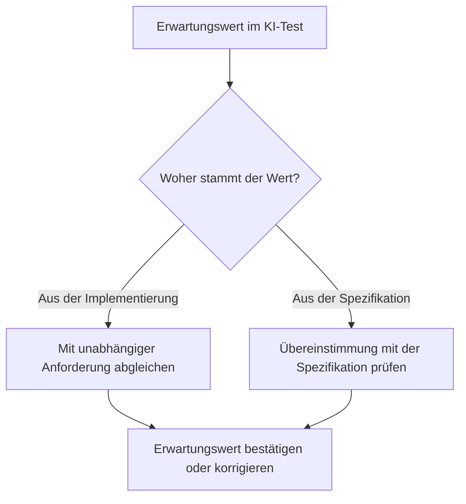
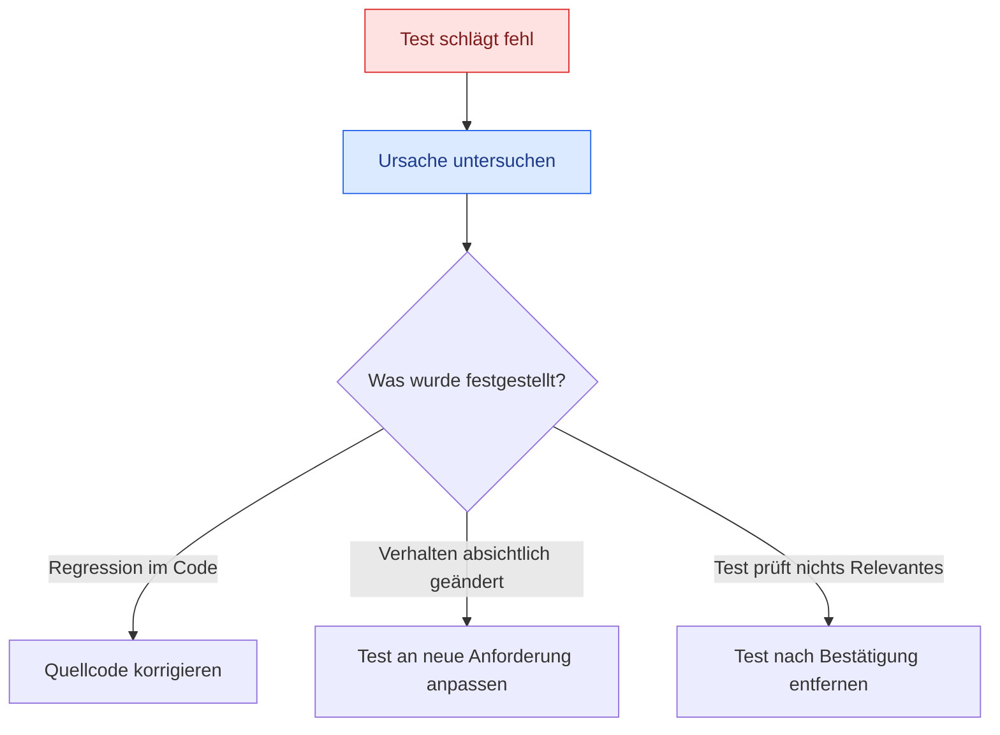
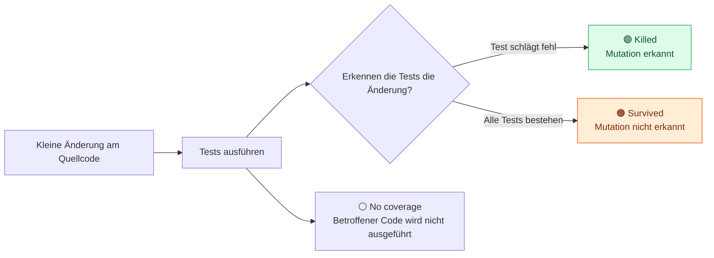

# KI-generierte Tests Best Practices

> **Kernaussage:** Eine grüne Testsuite zeigt, dass die Tests bestehen. Ob sie sinnvoll sind und Fehler erkennen, muss durch Review und gezielte Qualitätsprüfung überprüft werden.

## 1. Drei Best Practices für bessere Tests

| Gewohnheit | Leitfrage | Verhindert |
|---|---|---|
| **Erwartungswerte zurückverfolgen** | „Woher stammt dieser erwartete Wert?“ | Bestehende Fehler als korrektes Verhalten festschreiben |
| **Die entscheidende Assertion finden** | „Welche falsche Ausgabe würde diese Prüfung erkennen?“ | Hohe Testabdeckung ohne wirksame Prüfungen |
| **Fehlschläge untersuchen** | „Warum schlägt der Test fehl?“ | Wertvolle Tests löschen, um die Suite wieder grün zu machen |

## 2. Erwartungswerte unabhängig vom Code prüfen

Wenn die KI eine Funktion ausführt und deren Ergebnis als Erwartungswert übernimmt, ist dieser Wert nur dann korrekt, wenn die Implementierung bereits korrekt ist. Genau das soll der Test aber erst überprüfen.

**Verlässliche Grundlage:** Anforderungen, Designnotizen oder Geschäftsregeln, die unabhängig vom Code existieren.

| Besonders kritisch | Worauf beim Review achten? |
|---|---|
| Grenzwerte und Schwellen | Gilt die Regel bei `> 10` oder bereits bei `>= 10`? |
| Off-by-one-Fehler | Stimmt der Übergang direkt vor, auf und nach der Grenze? |
| Minimum und Maximum | Sind die Grenzen eingeschlossen oder ausgeschlossen? |

## 3. Assertions müssen etwas Entscheidendes prüfen

Eine **Assertion** ist die Prüfung, die ein falsches Ergebnis erkennen soll. Sie trägt den Test nur dann, wenn sie relevante Fehlverhalten unterscheidet.

**Beispiel:** `result is not None` prüft lediglich, dass ein Ergebnis vorhanden ist. Ein falscher, aber vorhandener Wert besteht diese Prüfung ebenfalls. Wenn ein konkreter Wert gefordert ist, muss der Test diesen prüfen.

| Schwache Prüfung | Wirksamere Prüfung |
|---|---|
| Ergebnis ist vorhanden | Ergebnis entspricht dem spezifizierten Wert |
| Funktion läuft ohne Fehler | Rückgabe und relevante Auswirkungen stimmen |
| Zwei fast identische Tests | Prüfen, ob sie tatsächlich unterschiedliche Fälle absichern |

**Review-Frage:** Was würde der Test noch beweisen, wenn seine Assertion entfernt würde? Fehlt eine relevante Prüfung, sollte sie verstärkt oder der unnütze Test entfernt werden.

Auch Duplikate fallen bei diesem Review auf: Gleiche Teststruktur mit unterschiedlichen Konstanten kann dasselbe Verhalten mehrfach prüfen. Unterschiedliche Werte sind jedoch sinnvoll, wenn sie etwa verschiedene Grenzfälle abdecken.

## 4. Fehlgeschlagene Tests sind Signale

**Erst untersuchen, dann entscheiden.** Ein roter Test ist kein Grund, ihn sofort zu löschen.

## 5. Mutation Testing: Wie gut erkennen die Tests Fehler?

Mutation Testing verändert den Quellcode gezielt in kleinen Schritten und führt die Tests für jede Änderung erneut aus.

| Beispiel einer Mutation | Absichtliche Veränderung |
|---|---|
| `>` → `>=` | Vergleichsgrenze verschieben |
| `+` → `-` | Rechenoperation verändern |
| Bedingung negieren | Entscheidung umkehren |

| Ergebnis | Aussage | Nächster Schritt |
|---|---|---|
| **Killed** | Die Tests erkennen die eingebaute Änderung | Wirksame Fehlererkennung für diesen Fall |
| **Survived** | Die Tests erkennen die Änderung nicht | Assertions und fehlende Fälle untersuchen |
| **No coverage** | Der betroffene Code wird von keinem Test ausgeführt | Fehlende Tests ergänzen |

Ein hoher Anteil erkannter Mutationen liefert zusätzliche Hinweise auf die Wirksamkeit einer Testsuite. Überlebende Mutationen zeigen mögliche Schwachstellen, die gezielt geprüft werden können.

### Im Vortrag genannte Tools – Namen korrigiert

| Sprache | Tool | Offizielle Quelle |
|---|---|---|
| Java | **PIT / PITEST**, mit Maven- und Gradle-Anbindung | [PIT](https://pitest.org/), [Gradle-Plugin](https://plugins.gradle.org/plugin/info.solidsoft.pitest) |
| JavaScript / TypeScript | **Stryker Mutator / StrykerJS** | [StrykerJS-Dokumentation](https://stryker-mutator.io/docs/stryker-js/introduction/) |
| Python | **mutmut** oder **MutPy** | [mutmut-Dokumentation](https://mutmut.readthedocs.io/en/latest/index.html), [MutPy-Projekt](https://github.com/mutpy/mutpy) |

*Die Bezeichnungen „PyTest“ für Java und „Striker Mutator“ im Transcript sind vermutlich Transkriptionsfehler. Gemeint sind PIT/PITEST und Stryker Mutator.*

## 6. Kompakte Review-Checkliste

- [ ] Erwartungswerte gegen unabhängige Anforderungen geprüft?
- [ ] Grenzwerte, Off-by-one-Fälle und Minimum/Maximum gezielt geprüft?
- [ ] Erkennt jede Assertion ein relevantes Fehlverhalten?
- [ ] Ähnliche Tests auf echten zusätzlichen Nutzen geprüft?
- [ ] Jeden Fehlschlag vor einer Änderung oder Löschung untersucht?
- [ ] Bei Bedarf Mutation Testing eingesetzt und Überlebende analysiert?

**Merksatz:** Tests ausführen zeigt, ob sie bestehen. Tests reviewen und mutieren zeigt, wie wirksam sie schützen.

---

*Grundlage: das bereitgestellte Vortrags-Transcript. Die Beispiele für stärkere Assertions und die Checkliste sind praktische Verdichtungen. Einordnung: Ein Nicht-null-Test kann sinnvoll sein, wenn genau dies die Anforderung ist. Ebenso sind ähnliche Tests nicht automatisch Duplikate. Mutation Testing liefert zusätzliche Evidenz, aber keine Garantie für Fehlerfreiheit; manche Mutationen verändern das beobachtbare Verhalten nicht und müssen entsprechend eingeordnet werden.*
