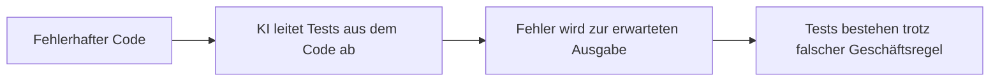
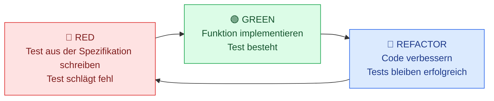
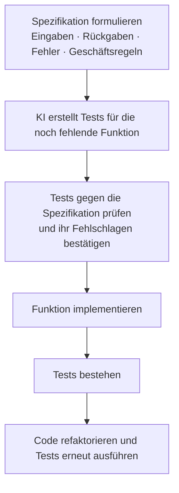

# TDD im Zeitalter der KI

> **Kernaussage:** KI-generierte Tests und Test-driven Development (TDD) ergänzen sich. Entscheidend ist, ob Tests das **bestehende Verhalten beschreiben** oder das **gewünschte Verhalten definieren**.

## 1. Warum TDD weiterhin relevant ist

KI kann Tests schnell erstellen. Das macht TDD jedoch nicht überflüssig: Tests aus vorhandenem Code prüfen dessen aktuellen Zustand; TDD beginnt mit der Spezifikation und legt fest, was eine noch zu entwickelnde Funktion tun soll.

| Aspekt | Tests aus bestehendem Code | TDD – mit oder ohne KI |
|---|---|---|
| Ausgangspunkt | Vorhandene Implementierung | Spezifikation und Anforderungen |
| Leitfrage | „Was tut der Code?“ | „Was soll der Code tun?“ |
| Zeitpunkt | Nach der Implementierung | Vor der Implementierung |
| Typischer Nutzen | Legacy-Code absichern, Testabdeckung erhöhen, Regressionen erkennen | Neue Funktionen und Geschäftsregeln präzise definieren |
| Zentrales Risiko | Ein bestehender Fehler kann zum erwarteten Verhalten werden | Fehler oder Lücken in der Spezifikation bleiben möglich |

## 2. Das Problem: Fehler als Erwartung festschreiben

Wenn die KI Tests aus fehlerhaftem Code ableitet, kann sie den Fehler als korrektes Verhalten übernehmen. Dadurch besteht der Code die Tests, obwohl er die Anforderung verletzt.

**Beispiel aus dem Vortrag:** Eine Regel gilt ab **10 Artikeln**. Die Implementierung verwendet jedoch **mehr als 10 Artikel**.

| Menge | Laut Spezifikation: `quantity >= 10` | Fehlerhafter Code: `quantity > 10` |
|---:|:---:|:---:|
| 9 | Regel gilt nicht | Regel gilt nicht |
| **10** | **Regel gilt** | **Regel gilt nicht ❌** |
| 11 | Regel gilt | Regel gilt |

**TDD setzt früher an:** Ein Test aus der Spezifikation prüft bereits den Grenzfall mit genau 10 Artikeln. Die Implementierung muss diesen Test erfüllen.

## 3. Der TDD-Zyklus: Red → Green → Refactor

1. **Red:** Das gewünschte Verhalten wird durch einen Test beschrieben. Die passende Implementierung fehlt noch, daher schlägt der Test fehl.
2. **Green:** Die Funktion wird so implementiert, dass sie den Test erfüllt.
3. **Refactor:** Der Code wird verbessert. Die Tests sichern dabei das geprüfte Verhalten ab.

## 4. So arbeiten KI und TDD zusammen

Bei **KI-gestütztem TDD** erstellt die KI den ersten Test aus einer Spezifikation – bevor die Funktion implementiert wird.

### Beispiel: `createInvoice` in Python

Die Funktion existiert noch nicht. Der Prompt beschreibt zunächst:

- **Eingaben:** Was nimmt die Funktion entgegen?
- **Rückgabe:** Welches Ergebnis soll sie liefern?
- **Fehlerfälle:** Welche Ausnahmen soll sie auslösen?
- **Geschäftsregeln:** Welche Bedingungen und Grenzwerte muss sie einhalten?

Anschließend lautet der Auftrag an die KI: **„Erstelle aus dieser Spezifikation einen zunächst fehlschlagenden Test für `createInvoice`.“** Erst danach folgt die Implementierung.

> **Gewinn:** Die Geschwindigkeit der KI wird mit dem spezifikationsbasierten Vorgehen von TDD verbunden. Es gibt keine vorhandene Implementierung, aus der die KI einen bestehenden Codefehler übernehmen könnte.

## 5. Entscheidungshilfe

| Situation | Passender Ansatz |
|---|---|
| Bestehenden Code verstehen und absichern | KI-generierte Tests aus dem Code; Erwartungen gegen Anforderungen prüfen |
| Regressionen verhindern | Bestehendes Verhalten durch Tests absichern |
| Neue Funktion oder Geschäftsregel entwickeln | TDD auf Basis der Spezifikation |
| Neue Funktion schneller mit Tests beginnen | KI-gestütztes TDD: Spezifikation → Tests → Implementierung |

**Merksatz:** Bestehendes Verhalten beschreiben → Tests aus dem Code. Gewünschtes Verhalten definieren → Tests aus der Spezifikation.

---

*Grundlage: das bereitgestellte Vortrags-Transcript. Einordnung: Die Aussage zur KI-Testgenerierung bezieht sich hier auf Tests, die aus bestehendem Code abgeleitet werden. Spezifikationsbasierte Tests verhindern das Übernehmen eines vorhandenen Codefehlers, garantieren aber keine fehlerfreie Spezifikation oder vollständige Testabdeckung. Der Prüfschritt im KI-Ablauf ist eine ergänzende praktische Empfehlung.*
